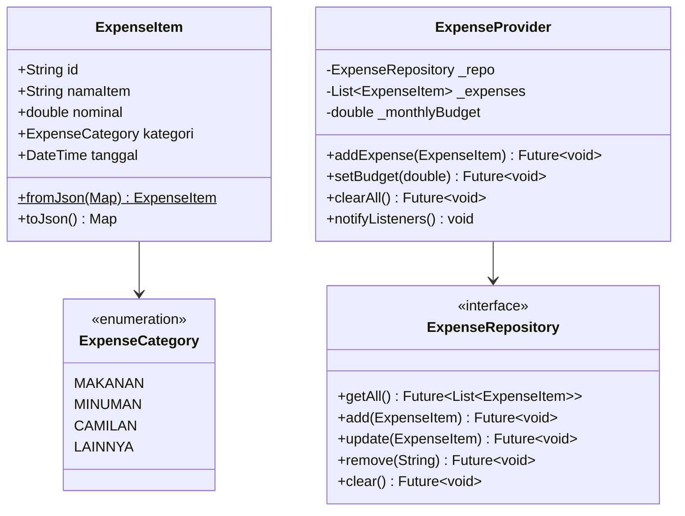

# Class Diagram — UniKantin

## Komponen Struktur Data

| Nama Class / Enum | Peran / Deskripsi | File Target M04 |
|---|---|---|
| `ExpenseItem` | Entitas model data transaksi pengeluaran kantin | `lib/models/expense_item.dart` |
| `ExpenseCategory` | Enum kategori pengeluaran (Makanan, Minuman, Camilan, Lainnya) | `lib/models/expense_category.dart` |
| `ExpenseRepository` | Interface abstraksi akses penyimpanan lokal (SQLite/Memory) | `lib/repositories/expense_repository.dart` |
| `ExpenseProvider` | State management (extends `ChangeNotifier`) pengelola UI state | `lib/providers/expense_provider.dart` |