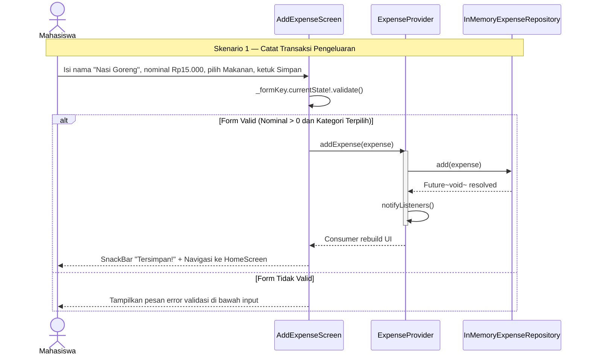

# Sequence Diagram — Skenario 1: Tambah Transaksi Sukses

**Topik:** UniKantin  
**Skenario:** Happy path — Pengguna berhasil mencatat pengeluaran kantin  
**Requirement:** FR-01, US-01

## Analisis Relasi Diagram → Kode

| Pesan dalam Diagram | Method Dart yang Akan Dibuat | File Target M04 |
|---|---|---|
| `SC ->> P : addExpense(expense)` | `ExpenseProvider.addExpense()` | `lib/providers/expense_provider.dart` |
| `P ->> R : add(expense)` | `InMemoryExpenseRepository.add()` | `lib/repositories/in_memory_expense_repository.dart` |
| `P ->> P : notifyListeners()` | Dipanggil setelah mutasi state data | `lib/providers/expense_provider.dart` |