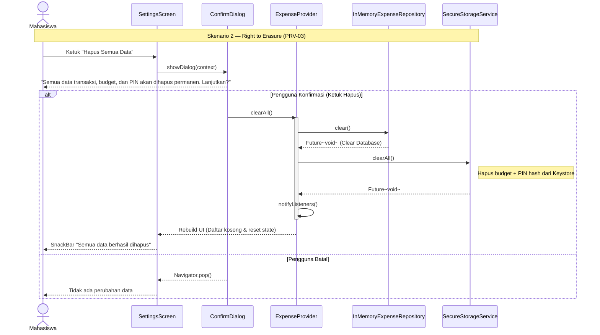

# Sequence Diagram — Skenario 2: Hapus Semua Data Mandiri (PRV-03)

**Topik:** UniKantin  
**Skenario:** Privasi — Pengguna mengeksekusi hak penghapusan data (UU PDP Ps. 8)  
**Requirement:** PRV-03, FR-05

## Catatan Keamanan / Privasi
- **PRV-03 (Right to Erasure):** Perintah `clearAll()` membersihkan data secara atomik dari dua tempat penyimpanan lokal sekaligus: `InMemoryExpenseRepository` (database transaksi) dan `SecureStorageService` (kredensial PIN hash & budget).