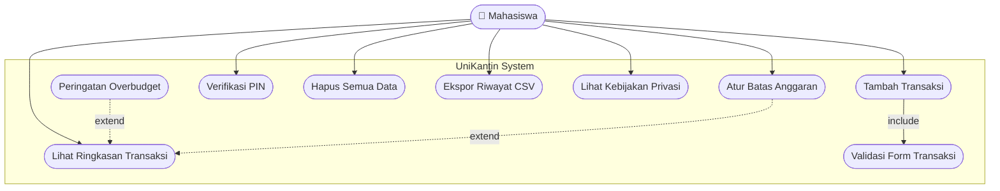

# Use Case Diagram — UniKantin

## Penjelasan Relasi

| Relasi | Jenis | Alasan |
|---|---|---|
| Tambah Transaksi → Validasi Form | `<<include>>` | Form transaksi **selalu** divalidasi sebelum data disimpan ke database lokal. |
| Peringatan Overbudget ↗ Lihat Ringkasan | `<<extend>>` | Peringatan **hanya** muncul jika akumulasi pengeluaran ≥ 80% dari batas anggaran. |
| Atur Batas Anggaran ↗ Lihat Ringkasan | `<<extend>>` | Tampilan ringkasan opsional diperbarui secara dinamis setelah nominal budget baru diset. |